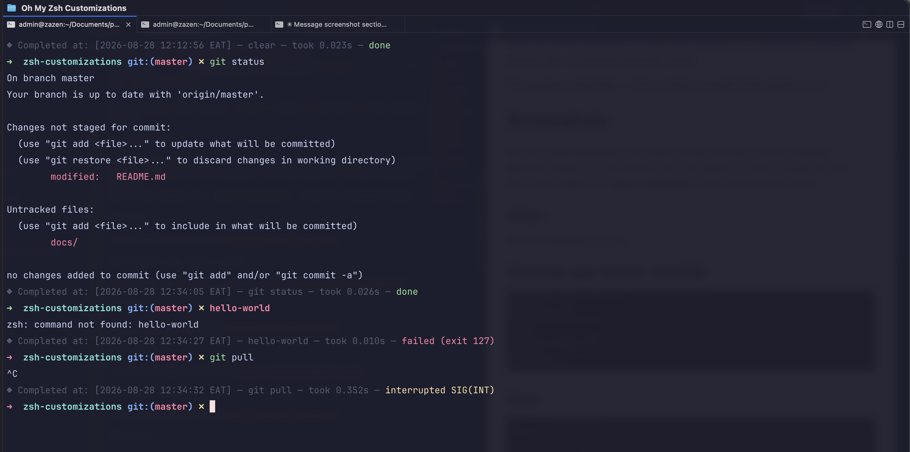
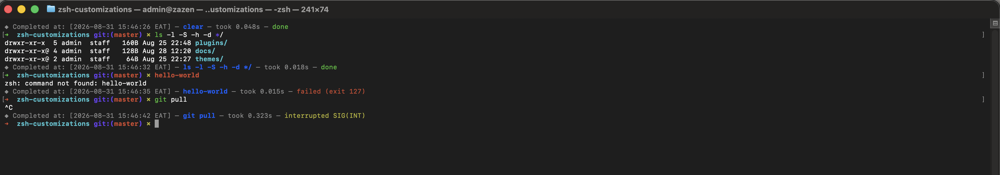
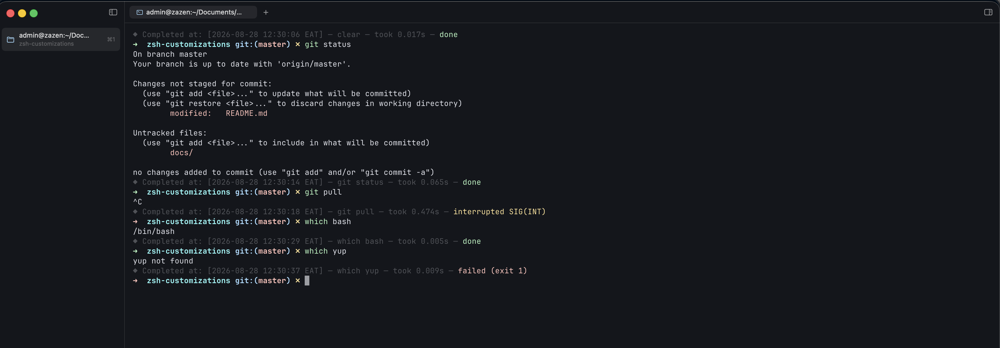
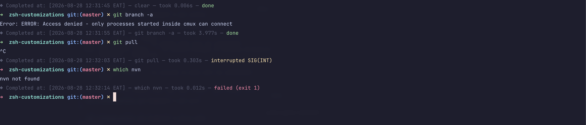
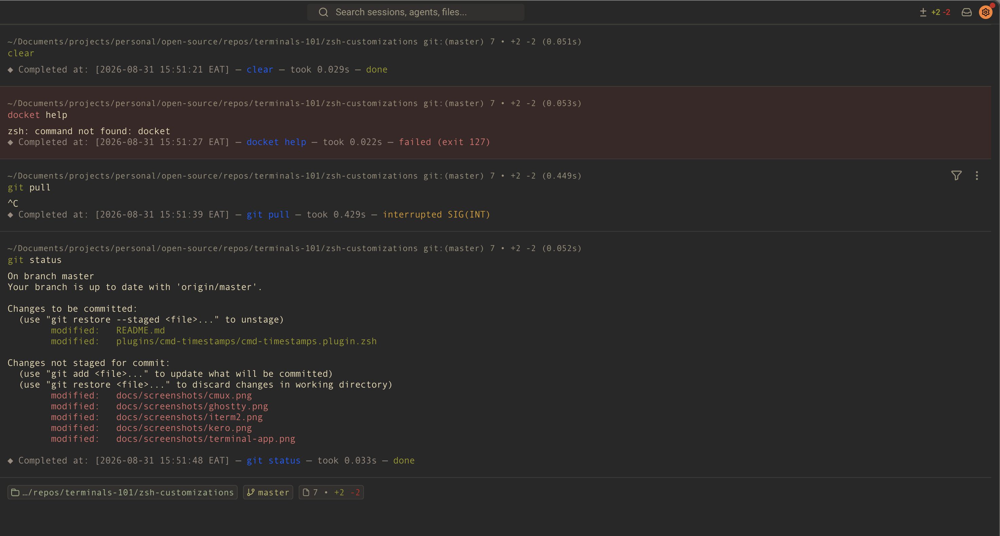
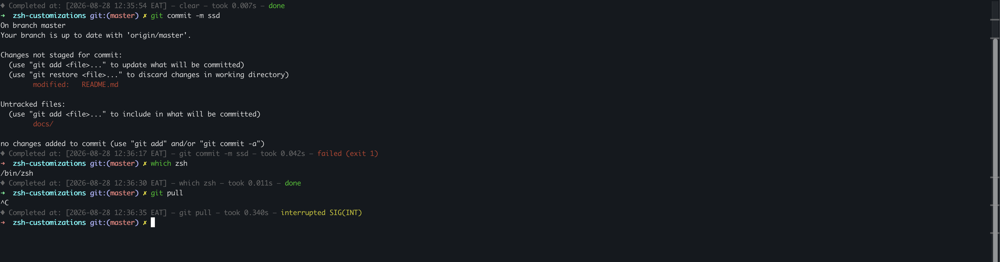

# zsh-customizations

A small collection of personal zsh plugins and themes.

## Layout

```
plugins/
  cmd-timestamps/     print timing info after every command
  cmd-history-log/    persistent, richer shell history
themes/               (empty for now)
```

## Plugins

### `cmd-timestamps`

After each command returns, prints a dim one-line summary: when it finished, what it was, how long it took, and how it ended.

```
◆ Completed at: [2026-08-25 21:04:37 EAT] — npm test — took 4.812s — done
```

#### Long commands are shortened

The line is a reminder, not a transcript — the full command is one `history`
away. Long commands are cut down by three standard rules, applied in order:

1. **Stop at the first `|`, `&&`, `||`, `;` or newline.** The first stage of a
   pipeline is what you meant to run.
2. **Keep the first few shell words.** Quoted arguments count as one word, so a
   commit message is never split across several.
3. **Shorten any single word that is still too long**, keeping its closing
   quote so a clipped string still reads as one.

A trailing `…` means something was dropped.

```
git commit -m "fix: rework the auth refactor"  →  git commit -m "fix: rework the au…"
docker build -t app:1.2 --build-arg X=1 -f Dockerfile .
                                               →  docker build -t app:1.2 --build-arg …
npm test | tee out.log                         →  npm test …
```

Tune it by setting these before sourcing the plugin (defaults shown):

```sh
TS_CMD_MAX_WORDS=5      # shell words kept
TS_CMD_MAX_WORD_LEN=20  # longest single word
TS_CMD_MAX_LEN=72       # hard cap on the whole command
TS_ELLIPSIS=…           # marker for "there was more"
```

### `cmd-history-log`

Logs every command to `~/.local/state/zsh/cmd_log`, recording timestamp, exit
code, user (and whether it ran as root), and the working directory it ran in.
Overrides the `history` builtin to print that log newest-first:

```
2026-08-25 21:04:32 EAT  [exit 0]  wangechi  ~/projects/api  npm test
```

Fields are stored separated by `\x1f` (unit separator), so commands containing
spaces, tabs, or newlines round-trip cleanly.

The log grows indefinitely — trim or rotate it yourself if that matters to you.

## Screenshots

How the `cmd-timestamps` line renders across terminals. Colors and glyph
alignment depend on the terminal's font and palette, so each one gets its own
shot. Drop images into `docs/screenshots/` using the filenames below.

### cmux



### Terminal.app (native macOS)



### Kero



### Ghostty



### Warp



### iTerm2



> Using a terminal that isn't listed? Screenshots welcome — add the image to
> `docs/screenshots/` and a matching section here.

## Installation

Clone the repo somewhere, then source the plugins you want from `~/.zshrc`:

```sh
git clone https://github.com/<you>/zsh-customizations.git ~/.zsh-customizations

# in ~/.zshrc
source ~/.zsh-customizations/plugins/cmd-timestamps/cmd-timestamps.plugin.zsh
source ~/.zsh-customizations/plugins/cmd-history-log/cmd-history-log.plugin.zsh
```

Then reload:

```sh
exec zsh
```

### With oh-my-zsh

Symlink the plugin directories into your custom plugins folder and enable them
by name:

```sh
ln -s ~/.zsh-customizations/plugins/cmd-timestamps  ~/.oh-my-zsh/custom/plugins/cmd-timestamps
ln -s ~/.zsh-customizations/plugins/cmd-history-log ~/.oh-my-zsh/custom/plugins/cmd-history-log

# in ~/.zshrc
plugins=(... cmd-timestamps cmd-history-log)
```

## Requirements

- zsh with the `zsh/datetime` module (standard in most builds)
- `tail -r` for `cmd-history-log`'s reverse output — available on macOS/BSD; on GNU/Linux swap it for `tac`
